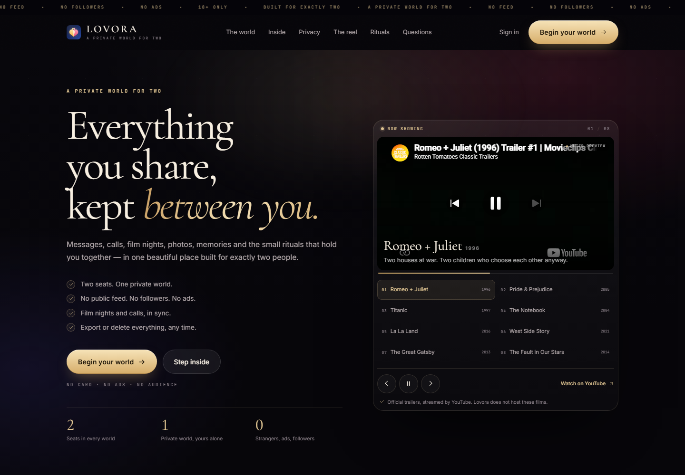
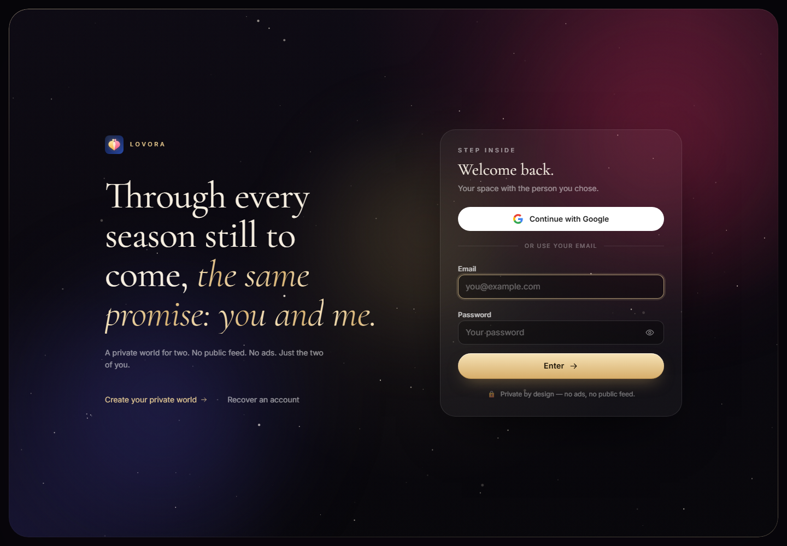
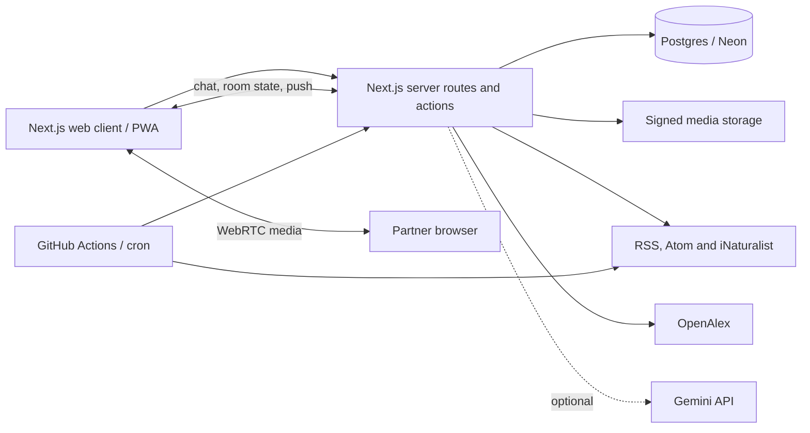

# Lovora

> A private, web-based shared world for exactly two people.

[](https://github.com/hassan200503/Lovora/actions/workflows/ci.yml)
[](https://nodejs.org/)
[](https://pnpm.io/)

**[Open the production app](https://lovora-app.vercel.app/)** · **[Report an issue](https://github.com/hassan200503/Lovora/issues)** · **[Deployment guide](DEPLOY.md)**

Lovora brings the parts of a couple's shared life that usually end up in separate apps into one private space: real-time messaging, encrypted calls, synchronized rooms, media, memories, rituals, personalized discovery, and research. It is an 18+ product designed for two members per world; it is not a social network, dating service, or group workspace.

## Production screenshots

The screenshots below were captured from the deployed production URL on 23 November 2026. They are checked-in repository assets, not mockups.

| Public landing page | Sign-in page |
| --- | --- |
|  |  |

## Core features

| Feature | What it provides |
| --- | --- |
| Private world for two | A couple-scoped data model with up to two active members, invitation-based pairing, first-party accounts, recovery codes, and session invalidation. |
| Realtime chats | Messages use durable writes plus short-interval synchronization for typing state, delivery/read receipts, replies, reactions, edits, delete-for-me, and delete-for-everyone. Photos and voice notes are supported. |
| Encrypted calls | 1:1 WebRTC voice and video calls send media directly between browsers using encrypted WebRTC transport. The service supplies signaling, ICE restart, optional TURN configuration, ringing, and web-push call alerts. |
| Together room | Shared listening and watching with a queue, room chat, persistent mini-player, server-versioned state, clock estimation, and drift correction. |
| Shared gallery | Couple-scoped photo, video, and audio storage with signed reads, media validation, image processing, and comments. It also supports optional live YouTube search and shelves for adding items to the shared gallery. |
| Built-in discovery browser | A reading-oriented browser inside Lovora for current discoveries. It presents curated source cards, filters, saved items, source health, detailed views, and outbound attribution links. |
| Personalized feeds | Each person follows interests and can favorite topics, mute or star sources, and hide categories or keywords. The combined feed deliberately interleaves followed topics and gives favorites additional prominence. RSS/Atom blogs, publishers, institutional sources, and iNaturalist are normalized into one feed. |
| AI research | Research combines OpenAlex study search with optional Gemini assistance. It supports cited study answers, simple explanations, structured lessons, quizzes, follow-up threads, sharing with a partner, and saving material to shared learning. |
| Shared story and rituals | Memories, milestones, adventures, plans, discoveries, a daily question, a weekly digest, and a shared learning list make the space useful beyond chat. |
| Personal space | Per-person profiles, dashboards, journals, projects, skills, radar, and a knowledge vault use explicit private/shared/public visibility. |

## Product boundaries

Lovora is intentionally constrained so its privacy and operating model remain clear.

- A world is limited to two people.
- There is no public feed, follower graph, advertising, or data-selling model.
- Public profiles are opt-in and expose only permitted public fields.
- Billing, licensed catalogue playback, screen sharing, replacement room transport, and public commons are feature-flagged **off** by default.
- The application is a responsive web/PWA product. A native mobile shell is not included in this repository.

## Architecture



### Repository layout

```text
apps/web/                 Next.js 16 application, API routes, UI, migrations, scripts
packages/domain/          Framework-independent product and brand types
packages/sync-protocol/   Deterministic room-sync protocol and simulator
packages/ui-tokens/       Shared design tokens
docs/                     Product, architecture, privacy, security, and runbook docs
security/                 Dependency-audit policy
```

### Implementation notes

- **Frontend:** Next.js 16 App Router, React 19, React Server Components, server actions, and TanStack Query.
- **Data:** Drizzle ORM over PostgreSQL. Local development and tests use embedded PGlite; production accepts a PostgreSQL connection such as Neon.
- **Realtime design:** chat and room state use polling with server-assigned versions; WebRTC carries call media; Web Push delivers alerts. No shared socket server is required.
- **Room synchronization:** the protocol is framework-free TypeScript with deterministic virtual-time tests for clock skew, latency, jitter, packet loss, and buffering.
- **Discovery pipeline:** source registry → RSS/Atom or iNaturalist adapters → normalization → quality filtering → URL de-duplication → topic tagging → PostgreSQL → keyset-paginated API → React Query feed.
- **Media:** couple-scoped paths, signed URLs, server-side MIME and size validation, EXIF stripping, and no DRM circumvention or downloaded streamed media.
- **Tenant isolation:** couple ownership is derived from the verified session. Personal visibility resolves through one access gate, and the test suite includes a cross-couple tenancy matrix.

## Quick start

### Prerequisites

- Node.js **24 or later**
- pnpm **12.21.0**, enabled through Corepack

```bash
git clone https://github.com/hassan200503/Lovora.git
cd Lovora
corepack enable pnpm
pnpm run setup
pnpm dev
```

Open [http://localhost:3000](http://localhost:3000). `pnpm run setup` installs the locked workspace dependencies, generates route types, and seeds fictional demo accounts. Generated demo credentials are written to `apps/web/.env.local`, which is ignored by Git.

To start without demo data, reset the local world and complete onboarding at `/welcome`:

```bash
pnpm reset
pnpm dev
```

Local development needs no database service. With `DATABASE_URL` unset, data lives in `apps/web/.data/`; only one process may use it at a time.

## Configuration

Copy the values you need from [`apps/web/.env.example`](apps/web/.env.example). Never commit `.env.local`.

| Variable | Required | Purpose |
| --- | --- | --- |
| `DATABASE_URL` | Production | PostgreSQL connection string. Leave unset for local PGlite. |
| `SESSION_SECRET` | Production if no `DATABASE_URL` | 32+ random characters used to sign sessions. |
| `CRON_SECRET` | Optional | Protects the HTTP trend-ingest trigger. |
| `GEMINI_API_KEY` | Optional | Enables Gemini-assisted research. It can also be set in the app's AI Research settings. |
| `GEMINI_MODELS` | Optional | Comma-separated model fallback order for research. |
| `YOUTUBE_API_KEY` | Optional | Enables live YouTube discovery in the shared gallery. |
| `VAPID_SUBJECT` | Optional | Contact value for web-push VAPID and OpenAlex polite-pool requests. |
| TURN variables | Optional | Configure Cloudflare, Metered, or a custom TURN relay for restrictive networks. |

The supported TURN settings are `CLOUDFLARE_TURN_KEY_ID` / `CLOUDFLARE_TURN_API_TOKEN`, `METERED_TURN_DOMAIN` / `METERED_TURN_API_KEY`, or `TURN_URLS` / `TURN_USERNAME` / `TURN_CREDENTIAL`. See [DEPLOY.md](DEPLOY.md) for provider-specific instructions.

## Scripts and verification

Run these commands from the repository root.

| Command | Purpose |
| --- | --- |
| `pnpm dev` | Run the web app in development mode. |
| `pnpm build` | Create production builds across the workspace. |
| `pnpm typecheck` | Generate route types and run TypeScript checks. |
| `pnpm lint` | Run ESLint. |
| `pnpm test` | Run unit and integration tests, including the real migrated PGlite schema. |
| `pnpm a11y` | Run the local axe-core WCAG 2.2 AA audit. |
| `pnpm motion` | Audit reduced-motion, flashing, and forced-colors behavior. |
| `pnpm audit:deps` | Run the repository dependency policy audit. |
| `pnpm check` | Run typecheck, lint, tests, and a production build. |
| `pnpm ingest --force` | Fetch an initial batch of live discovery content. |
| `pnpm retag` | Re-apply topic rules to stored discoveries. |

GitHub Actions runs a frozen-lockfile install, route type generation, typechecking, linting, tests, production build, and dependency audit on pushes to `main` and pull requests. See [CI workflow](.github/workflows/ci.yml).

## Deploying

The verified deployment is **https://lovora-app.vercel.app/**.

The repository includes a no-card deployment path using:

1. **Neon** for production PostgreSQL.
2. **Vercel** for the Next.js application, with `apps/web` as the project root.
3. **GitHub Actions** for scheduled discovery ingestion.

Set `DATABASE_URL` in the host environment before the first production deployment. The `vercel-build` script applies migrations before building. For calls on restrictive mobile networks, configure a TURN relay. The complete provider setup, scheduled ingest, web-push behavior, and operational constraints are documented in [DEPLOY.md](DEPLOY.md).

## Privacy and security

- Couple-owned records are scoped by `couple_id`; request input never decides the tenant.
- Personal content has a defined visibility: **private**, **shared**, or explicitly opted-in **public**.
- Passwords use bcrypt; sessions are signed, httpOnly, 30-day JWTs carrying a session version so password changes and sign-out-everywhere invalidate old sessions.
- Partner invitations are single-use, hashed, expire after seven days, and are consumed transactionally.
- Secrets such as AI keys and configured relays are stored sealed at rest when saved in the app.
- Security headers are provided through Next.js and runtime secrets stay out of the repository.

Read the detailed [security notes](docs/SECURITY.md), [privacy design](docs/PRIVACY.md), and [architecture](docs/ARCHITECTURE.md) before operating a public deployment.

## Documentation

- [Product definition](docs/PRODUCT.md)
- [Architecture](docs/ARCHITECTURE.md)
- [Design system](docs/DESIGN.md)
- [Deployment guide](DEPLOY.md)
- [Runbook](docs/RUNBOOK.md)
- [Verification notes](docs/VERIFICATION.md)
- [Feature parity](docs/PARITY.md)

## Contributing

Before opening a pull request, run the checks relevant to your change. New couple-owned data must retain session-derived tenancy, migrations, and cross-couple coverage. New visible personal data must pass through the shared visibility rule. Follow the pull-request evidence template in [`.github/pull_request_template.md`](.github/pull_request_template.md).

## License

No license file is currently included in this repository. Do not assume permission to reuse or redistribute the code until the project owner publishes a license.
